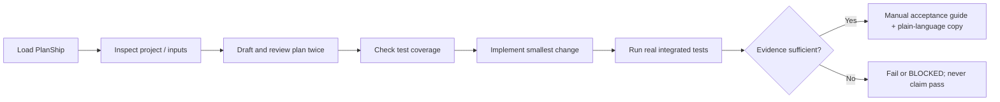

# PlanShip

[简体中文](README.zh-CN.md) | **English**

> An evidence-driven AI coding workflow for Codex and Claude Code: implementation plans, two review rounds, minimal code changes, real tests, and acceptance.

**PlanShip** is a reusable AI Coding Skill, not a background agent, test framework, or project manager. It insists on a reviewed plan, the smallest sufficient code change, genuine test evidence, and understandable handoff documents. Installed files alone do not prove an AI agent actually invoked the Skill.

**Use PlanShip when** you need more than a prompt for coding: a reviewed implementation and test plan, a trustworthy post-integration validation trail, and a handoff people can verify. It provides **plan / execute / full workflow** modes. See the [FAQ](docs/faq.md), [workflow architecture](docs/architecture.md), and [real Java negative-control example](examples/java-order-total/README.md).

**Not a guarantee:** automatic Skill activation, test correctness, production acceptance, Google indexing and AI recommendations require their own evidence. PlanShip's checks do not make an autonomous agent, replace JUnit or certify results. The normative Skill rules are English-first; **formal plan validators still require Chinese section/review field labels**, so fully English structured plans are not yet supported. [Language contract](docs/language-policy.md).

## Why it exists

Coding agents can skip review, modify unrelated features, declare `PASS` without exercising business behavior, or produce technical documentation that non-engineers cannot follow. PlanShip adds **explicit workflow gates** instead of trusting a success message.

## Capabilities

| Area | Contract |
| --- | --- |
| Plan | Inspect actual project files and provided attachments; draft and improve the plan through at least two substantive review rounds |
| Scope | Built-in minimal scope; optionally integrate `code-pact` |
| Inputs | Scan optional `test-dir/` automatically; ask once only when essential inputs are missing |
| Implement | Review missing test cases before changes; allow local worktrees and final integration retest |
| Test | Require real framework tests, meaningful assertions, fresh evidence and source fingerprints; never fake success |
| Accept | Generate step-by-step manual verification instructions after automated acceptance gates pass |
| Explain | Pair each technical Markdown with a plain-language Markdown and same-stem offline HTML in `大白话解释/` |
| Archive | Stable, idempotent numbered documents under `.idea/docs/<plan-name>/` |

## Requirements and optional integrations

**Core workflow: zero external runtime dependencies.** Install the PlanShip Skill folder into a supported Codex/Claude Skills directory (its bundled `references/` are part of the core instructions); PlanShip itself can run via the host's native project-reading, editing, documentation and test capabilities. **WebCodex Runner, Python, MCP, Git, `code-pact`, and `gen-ui` are not prerequisites.** Real business tests still require the applicable project test runtime (Maven, Gradle, pytest, etc.). If unavailable, report that test as `未验证`, not `PASS`.

Optional enhancements (never downloaded automatically): [code-pact](https://github.com/yeqiana/code-pact) for review/minimal-change discipline, [gen-ui](https://github.com/yeqiana/gen-ui) for presentation. Python 3.11+ provides optional document publication/verification and evidence utilities. Without Python, use native host tools, verify paired files and numbering manually, and report that automated validation and atomic publication were not verified.

Only when the user **explicitly requests optional installation**, run:

```powershell
python .\scripts\preflight.py --project "D:\workspace\my-project" --host codex --install-optional --read-content --json
```

By default preflight is read-only. See [optional integrations](docs/dependencies.md).

## Installation

Windows PowerShell, Codex user-level Skills:

```powershell
git clone https://github.com/yeqiana/plan-ship.git "$HOME\.agents\skills\plan-ship"
Test-Path "$HOME\.agents\skills\plan-ship\SKILL.md"
```

Claude Code:

```powershell
git clone https://github.com/yeqiana/plan-ship.git "$HOME\.claude\skills\plan-ship"
Test-Path "$HOME\.claude\skills\plan-ship\SKILL.md"
```

Your host may use a different Skills root. Start a fresh agent session after installation; verify that the active Skill is `name: plan-ship`. Do not accidentally nest the repository as `plan-ship/plan-ship/SKILL.md`.

## Usage

Codex, **English**:

```text
$plan-ship plan: Inspect this Java repository, present a scoped implementation, test and acceptance plan, and complete two substantive review/revision rounds before publishing it.
$plan-ship execute: Implement the reviewed plan with minimal changes; run real integrated tests and produce a manual verification guide with a readable companion.
$plan-ship all: Plan, review, implement, test and accept this feature without making unsupported PASS claims.
```

Codex, **Chinese**:

```text
$plan-ship 方案编写：Review the existing Java project, draft a minimal implementation/test/acceptance plan, then run two real improvement rounds.
$plan-ship 方案实施测试验收：Implement the accepted plan and run real tests, then produce manual acceptance instructions.
$plan-ship 全流程：Plan, review twice, implement minimally, test and accept without skipping gates.
```

Claude Code uses `/plan-ship` instead of `$plan-ship`. Natural-language auto-invocation depends on the host and is **not guaranteed**; explicit invocation is the dependable option.

## Workflow



Missing test fixtures are requested only if the actual requirement cannot be validated without them. Plans can describe remaining limitations, but unrun tests cannot be marked passed.

## Output layout

```text
<project>/.idea/docs/<plan-name>/
├── 1. <plan-name>-实施测试验收方案.md
├── 2. <plan-name>-手动测试验收方案.md
├── 大白话解释/
│   ├── 1. <plan-name>-实施测试验收方案.md
│   ├── 1. <plan-name>-实施测试验收方案.html
│   ├── 2. <plan-name>-手动测试验收方案.md
│   └── 2. <plan-name>-手动测试验收方案.html
├── evidence/
└── .document-index.json
```

An additional test-case addendum appears only if needed; stable numbering never renumbers existing files. The plain-language companion must explain the problem, before/after behavior, analogy, diagrams, validation steps, risks, status and terminology; automatic readability checks are a minimum gate, not proof that a human reader understands.

## Optional local checks (requires Python, not needed for core usage)

```powershell
python .\scripts\preflight.py --project "D:\workspace\my-project" --host codex --read-content --json  # optional read-only
python .\scripts\test_input_probe.py --workspace "D:\workspace\my-project"
python .\scripts\route_manager.py              # read-only route check
python .\scripts\route_manager.py --install    # opt-in: existing user instructions get a manual patch, never overwritten
```

Each published plain-language Markdown also receives a same-stem **offline responsive HTML** companion (never for technical Markdown). It follows the optional [gen-ui](https://github.com/yeqiana/gen-ui) presentation guidelines; no script, CDN or external runtime is required to view it. Use `python scripts/doc_registry.py sync-html --workspace <project> --name <plan-name>` for a **read-only migration preview**, then add `--apply` for indexed/verified files; unmanaged or manually modified HTML is never overwritten. Every plan includes a static offline `大白话解释/index.html` main entry linking all registered explanation HTML pages. See the [HTML guide](docs/plain-html.md).

For former installations, see the [migration guide](docs/migration.md). Never overwrite existing user instructions without consent.

## Maintainer test and release checks (requires Python)

```powershell
python -m pip install pytest
python .\scripts\validate_package.py
python -m unittest discover -s tests -p "test_*.py" -v
```

The optional Python checks above are for maintainers, not mandatory when using the Skill. GitHub Actions runs the package and regression checks. **Passing this repository's tests is not a production acceptance certificate for a user's business system.** Host-level auto-invocation is separately covered by [manual evaluation](evals/manual-evaluation.md), and detailed gates are documented in [quality gates](docs/quality-gates.md).

## v1.3.1 review fixes

The optional validators now reject trivially self-confirming Python/Java assertions, distinguish structural checks from real semantic acceptance, and flag keyword-stuffed explanations for review. A controlled negative test that turns red when the implementation is deliberately broken is still required for critical paths. Route-file updates detect cooperative and observable concurrent changes; non-cooperating changes inside the final replace window cannot be guaranteed safe by a portable script. Preflight reports missing or unverified host activation rather than asserting readiness. The optional document publisher can recover validated pre-journal interruptions without deleting unknown user files.

**The core Skill still requires no Python, WebCodex Runner, Git, MCP or additional Skills.** See [quality gates](docs/quality-gates.md).

## Boundaries

- Ordinary PlanShip execution permits local Git changes but prohibits remote pushes, branches, and PRs unless the user gives a separate explicit instruction to perform those external actions.
- Printed `PASS`, empty tests, stale reports and unchecked business behavior never count as acceptance.
- No invented screenshots, image assets or human verification results.
- Plain Markdown is the built-in fallback; `gen-ui` is an optional presentation integration.

## Explore / source of truth

- [English FAQ — common Codex / Claude Code questions](docs/faq.md)
- [Architecture and workflow gates](docs/architecture.md)
- [PlanShip vs templates, coding guardrails and test frameworks](docs/comparison.md)
- [Reproducible Java example with an intentionally failing negative control](examples/java-order-total/README.md)
- [Language policy / 语言规范](docs/language-policy.md)
- [Evidence-first GEO / discoverability methodology](docs/geo-methodology.md)
- [GitHub About / Topics recommendations and verification](docs/github-metadata.md)
- [Fixed discovery evaluation prompts — initial status NOT MEASURED](evals/discovery-baseline.md)

**Canonical repository:** https://github.com/yeqiana/plan-ship . `SKILL.md` is the single normative Skill entry. Markdown examples and SEO documents must never override its safety or evidence rules. Do not treat search discoverability as a measured success without real observations.

## Project layout

`SKILL.md` defines behavior; `agents/openai.yaml` describes the Codex entry point; `references/` contains detailed contracts; `assets/templates/` contains writing templates; `scripts/` contains optional validation helpers; `tests/` tests it; `docs/`, `examples/`, and `evals/` provide guidance and human evaluation.

## License

MIT, see [LICENSE](LICENSE).

## v1.3.2 — Acceptance evidence is not just consistency

A green JUnit report plus matching source hashes is **not** final business acceptance. `validate_evidence.py` defaults to `CONSISTENCY_PASS_ACCEPTANCE_NOT_VERIFIED`. Use `--gate acceptance` to require a failing counterfactual JUnit testcase, matching failure-log fingerprints, a concrete production-code mutation snapshot and exact diff, unchanged test-source fingerprint, and an associated restored integrated run for each accepted requirement. The result is still `COUNTERFACTUAL_MUTATION_ARTIFACTS_LINKED_HUMAN_REVIEW_REQUIRED`; locally writable artifacts cannot prove who actually executed the mutation. See [evidence contract](references/evidence-contract.md).

Opt-in `route_manager.py --install` uses exclusive creation for missing user instruction files. If `AGENTS.md` / `CLAUDE.md` already exists, it returns a **manual merge snippet** and never replaces it, avoiding the unprotected compare/rename race.

## v1.3.4 — Offline HTML index & controlled mutation evidence

Every registered explanatory Markdown has a same-stem static HTML; `大白话解释/index.html` provides the **main entry** for all registered explanation documents. Technical documents remain Markdown only. Rendering follows [gen-ui](https://github.com/yeqiana/gen-ui) accessibility/presentation guidance without requiring or installing the Skill. See [HTML guide](docs/plain-html.md).

Existing HTML is updated **only** when it is registered and still matches the prior hash; unknown/manual HTML is never overwritten. `sync-html` previews changes by default; `--apply` explicitly publishes all safe changes and the entry/index together.

Final `validate_evidence.py --gate acceptance` additionally requires an instrumented `run_mutation.py` execution record linked to the actual production-source mutation, the loaded module SHA, unchanged test source, a failing real pytest testcase, and matching JUnit/log provenance. Java/other runner adapters are not yet implemented: mark those controlled checks **unverified**, never pretend that static assertion scanning proves acceptance. The record is **locally writable**, not cryptographic attestation; independent review still applies.
