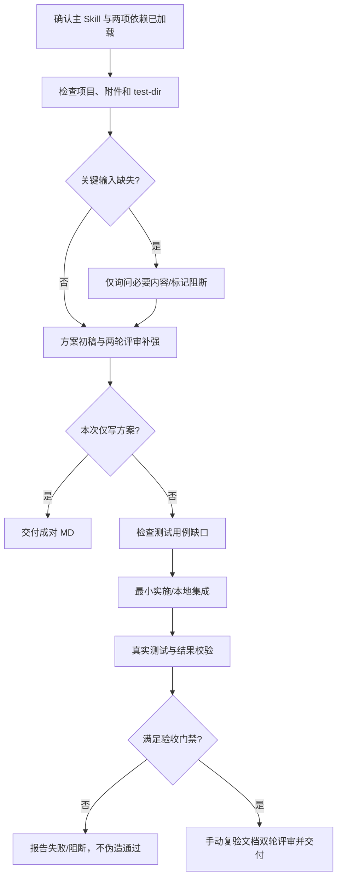

# PlanShip

**简体中文** | [English](README.md)

> 给 Codex / Claude Code 一套可复核的“先写方案、两轮评审、最小实施、真实测试、人工复验”交付流程。

**PlanShip** 是一个可安装的 AI Coding Skill，不是后台服务、自动测试框架或项目管理平台。它不会因为目录中存在 `SKILL.md` 就自动获得执行权限，也不会替你伪造测试成功。

## 为什么需要

常见的 AI 开发交付问题包括：方案未经评审就开工、顺手重构旧功能、缺少测试素材却宣称通过、手动验收步骤无法复现，以及文档专业术语太多。PlanShip 用明确的阶段和证据门禁约束这些行为。

## 核心能力

| 能力 | 行为 |
| --- | --- |
| 方案编写 | 结合真实项目、需求、当前会话文件，产出初稿并进行至少两轮**真实评审与补强** |
| 最小改动 | 加载 `ai-coding-collaboration` 后优先复用现有实现，保护旧功能 |
| 自动探测 | 扫描项目 `test-dir/`，仅在关键测试文件缺失且必须获取时询问一次 |
| 实施测试 | 评审合格后实施；缺测试用例先补充并评审两轮；合并后重新执行真实测试 |
| 禁止虚假测试 | 拒绝 `echo PASS`、恒真断言、旧报告、未执行测试、伪造验收通过 |
| 人工验收 | 自动化验收满足门禁后，生成可照做的手动测试步骤，不冒充用户完成操作 |
| 双副本 | 技术 MD 与非技术读者可理解的“大白话解释”同编号、同版本、成对更新 |
| 幂等文档 | `.idea/docs/<方案名称>/` 中按逻辑身份稳定编号，避免重复生成与重排 |

## 安装前准备

- Python 3.11+：运行自带脚本和测试；本地安装无需额外后台服务。
- **必须存在并能实际读取** `ai-coding-collaboration` 和 `intelligent-ui` 两个依赖 Skill。缺失时按规则 `BLOCKED`；不是自动下载或默默降级。
- 如果需要自动化测试证据，项目自身还需安装对应测试运行环境（如 `pytest` / Maven / Gradle）。

### Windows · Codex（推荐）

```powershell
git clone https://github.com/yeqiana/plan-ship.git "$HOME\.agents\skills\plan-ship"
Test-Path "$HOME\.agents\skills\plan-ship\SKILL.md"
```

### Windows · Claude Code

```powershell
git clone https://github.com/yeqiana/plan-ship.git "$HOME\.claude\skills\plan-ship"
Test-Path "$HOME\.claude\skills\plan-ship\SKILL.md"
```

上述路径是常见用户级位置；你的宿主可能采用工作区级 Skill 目录或自定义路径。安装后**开启新会话**，确认实际读取的是新目录中的 `name: plan-ship`。不要把完整仓库解压成 `plan-ship/plan-ship/SKILL.md`。

## 三种使用模式

**方案编写：** 不修改业务代码，只输出方案初稿、至少两轮评审补强与最终技术/大白话 MD。

```text
$plan-ship 方案编写：为当前项目增加 IM 冷热库拆分能力。
只改本需求相关部分，先加载协作 Skill，再评审两轮，保存到 .idea/docs/。
```

**方案实施测试验收：** 读取已经通过门禁的最终方案，检查缺失用例和测试材料，实施、合并、真实测试，最后交付手动复验方案。

```text
$plan-ship 方案实施测试验收：按 .idea/docs/IM冷热库拆分 的正式方案执行。
只允许本地 Git 变更；任何未运行的测试都必须标记“未验证”。
```

**全流程：** 在前置依赖、文件与权限允许时连续执行两个模式。

```text
$plan-ship 全流程：为当前 Java 项目新增一次性验证码校验。
先最小方案、双轮评审，再实施和实际测试，最终输出可操作的手动验收步骤。
```

Claude Code 可把 `$plan-ship` 换为 `/plan-ship`。自然语言触发属于宿主匹配能力，**不能保证每次自动触发**；显式调用最可靠。

## 流程图



图解：箭头表示执行顺序，不是实际运行证明；出现关键阻断时只能完成不依赖该输入的部分，不能跳过门禁宣布成功。

## 输出目录示例

```text
<项目根>/.idea/docs/IM冷热库拆分/
├── 1. IM冷热库拆分-实施测试验收方案.md
├── 2. IM冷热库拆分-手动测试验收方案.md
├── 大白话解释/
│   ├── 1. IM冷热库拆分-实施测试验收方案.md
│   └── 2. IM冷热库拆分-手动测试验收方案.md
├── evidence/               # 真实运行日志、报告和输入指纹
└── .document-index.json    # 稳定编号索引
```

有测试用例缺口时才会生成“测试用例补充”文档并占用一个序号，旧文档的编号不会重排。

## 大白话解释有什么不同？

面向不了解技术的读者：先解释“要解决什么问题”“改动前后有何变化”，再用生活类比、**有文字说明的**图、可照做的操作、风险和专业术语解释，帮助普通人理解。并非机械替换术语或复制技术正文。自动脚本只能检查结构底线；能否真的看懂仍需真实读者反馈。

详见 [大白话规范](references/plain-language.md) 与 [示例](examples/quickstart.md)。

## 本地检查

```powershell
# 依赖探测只读，不代表 Agent 已加载
python .\scripts\preflight.py --project "D:\workspace\your-project" --read-content --json

# 测试素材探测，无必需文件时不询问
python .\scripts\test_input_probe.py --workspace "D:\workspace\your-project"

# 可选：检查 Codex/Claude 常驻路由（不会修改）
python .\scripts\route_manager.py

# 仅经明确同意才写入用户级 AGENTS.md/CLAUDE.md
python .\scripts\route_manager.py --install
```

如果以前安装过旧名称，请按 [迁移指南](docs/migration.md) 清理旧路由标记，避免两个 Skill 同时匹配。**不要直接覆盖用户已有的 `AGENTS.md`/`CLAUDE.md`。**

## 开发和发布验证

```powershell
python -m pip install pytest
python .\scripts\validate_package.py
python -m unittest discover -s tests -p "test_*.py" -v
```

CI 同样运行静态结构校验和完整回归测试。业务验收另需在实际项目上执行框架测试和必要的反事实验证；仓库自身测试通过，**不等于你的业务系统已经验收通过**。

人工触发与行为检查参阅 [手动评测规范](evals/manual-evaluation.md)，质量边界详见 [质量门禁](docs/quality-gates.md)。

## 注意事项

- **不会自动推送代码：** Skill 工作流默认禁止远端 Git 操作；本仓库的维护者发布行为是单独授权的操作。
- **不会强行询问：** `test-dir` 不存在且测试不需要额外文件时自动继续。真正必需的文件缺失时才提出一个有原因的具体问题。
- **不会伪造证据：** 没运行就写“未执行”，测试失败就写失败；静态断言扫描不能保证任意业务测试的意义。
- **不会强制生成图片：** 使用普通 Markdown、Mermaid 和文本图解，让 GitHub、VS Code 与 CLI 都能阅读；不会把不存在的截图写成已采集。

## 国际化与 GEO（AI 搜索可发现性）

PlanShip 采用**英文权威 Skill 规范 + 中文关键词兼容 + 中英双语 README**。英文调用支持 `$plan-ship plan`、`$plan-ship execute`、`$plan-ship all`；中文版仍支持 `方案编写`、`方案实施测试验收`、`全流程`。所有核心验收门禁及中文 `大白话解释/` 兼容目录保持不变。

- [英文常见问题 FAQ](docs/faq.md)：面向 Codex、Claude Code 与 AI 搜索的真实问答。
- [能力边界与对比](docs/comparison.md)：明确 PlanShip 不是自动 Agent 引擎，也不能替代测试框架。
- [执行架构图](docs/architecture.md)：每一道 Gate 的真实作用。
- [可复现 Java 示例](examples/java-order-total/README.md)：实际运行正确逻辑，并验证故意修改后的错误逻辑会被测试捕获。
- [国际化约定](docs/language-policy.md) / [GEO 实施原则](docs/geo-methodology.md) / [GitHub 推荐元数据](docs/github-metadata.md)。
- [GEO 检索基线问题集](evals/discovery-baseline.md)：初始状态为 `NOT MEASURED`，不能自报 GEO 权重或 AI 推荐率。

英文化不意味着已经在 Codex/Claude 原生宿主验证了自动触发，也不意味着已被 Google 或任何 AI 搜索平台收录。仓库文档通过与业务项目测试通过是不同的事。

## 仓库内容

`SKILL.md` 为主规则；`agents/openai.yaml` 为 Codex 元数据；`references/` 为详细约束；`assets/templates/` 为模板；`scripts/` 为可执行校验工具；`tests/` 为自动回归；`docs/`、`examples/`、`evals/` 为使用与人工验收材料。

## License

MIT，详见 [LICENSE](LICENSE)。
