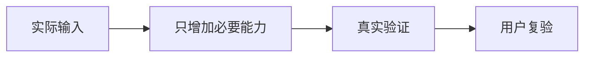

# {{技术文档标题}}：大白话解释

## 一句话结论

{{必须逐一解释技术版‘核心业务概念’中明确列出的实际业务词汇；通用类比不能代替业务内容}}

{{说清楚本文件是为谁解决什么问题，不要出现无解释的技术缩写}}

## 为什么要做

{{现在遇到什么麻烦；如果不改，对普通用户有什么影响；不能虚构实际故障}}

## 改动前后

| 场景 | 以前是什么情况 | 修改后期望看到什么 | 哪些保持不变 |
|---|---|---|---|
| {{实际场景}} | {{原状}} | {{可观察新行为}} | {{原有功能}} |

## 生活类比

{{使用与业务相贴切的生活情景，指出类比哪里相似、哪里不完全相同。不要用类比代替真实技术条件。}}

## 图解：从开始到结束

{{图解说明：从左到右每个节点是什么；箭头表示什么；如图不足以解释，则补充实际场景和失败分支。}}

## 怎么验证

{{第一步：实际操作和前置条件；第二步：输入什么；第三步：应该看到什么；失败时如何定位。人工没执行就写未执行。}}

## 风险与状态

{{对照技术版的风险、BLOCKED、未执行、未通过、未验证等状态及证据链接。不得美化结果。}}

## 术语小词典

| 术语 | 用日常语言解释 | 在本次方案中的作用 |
|---|---|---|
| {{术语}} | {{解释}} | {{作用}} |
