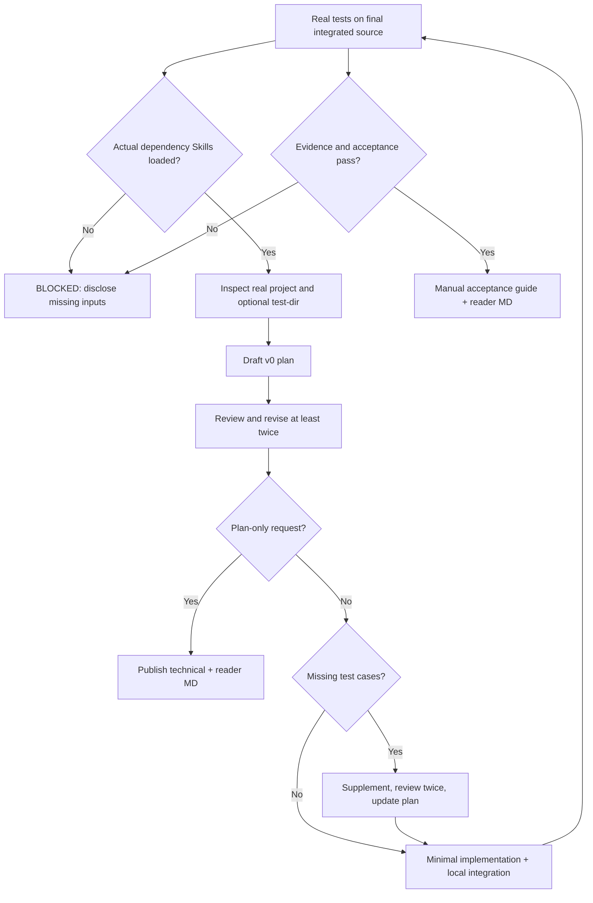

# PlanShip workflow architecture

PlanShip is a portable Skill package: Markdown instructions plus local Python verification utilities. There is **no server, database, scheduler or model API** bundled with the Skill.

**How to read the diagram:** each arrow is a required transition, not a claim that it happened in any particular session. If dependencies, relevant test cases or reliable evidence are missing, the corresponding gate remains blocked. A plan-only request never modifies business code.

## What the files do

- [`SKILL.md`](../SKILL.md): authoritative English-first normative contract with bilingual triggers.
- [`agents/openai.yaml`](../agents/openai.yaml): optional Codex discovery metadata, not a guaranteed runtime hook.
- [`references/`](../references/): stage-specific detailed rules and limits.
- [`scripts/preflight.py`](../scripts/preflight.py): helps identify Skill files, not whether the Agent truly followed them.
- [`scripts/test_input_probe.py`](../scripts/test_input_probe.py): inventories optional input fixtures without an unconditional question.
- [`scripts/doc_registry.py`](../scripts/doc_registry.py): stable numbering, paired publish and recovery.
- [`scripts/run_and_record.py`](../scripts/run_and_record.py): runs an actual test command and captures evidence.
- [`scripts/validate_evidence.py`](../scripts/validate_evidence.py): checks final code/test/plan consistency, not independent correctness.

## Data and trust boundaries

The user task and project files remain local to the Agent's authorized runtime. Test artifacts are stored in `<project>/.idea/docs/<plan-name>/evidence/`. The Skill cannot prevent subprocess network access or malicious local file tampering; controlled Runner/CI policy and independent review remain necessary. Do not publish user-private project evidence to the public PlanShip repository.
